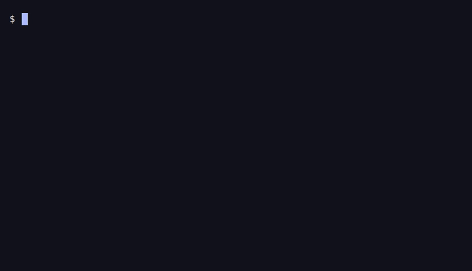

<p align="center">
  <picture>
    <source media="(prefers-color-scheme: dark)" srcset=".github/assets/banner-dark.svg">
    
  </picture>
</p>

<p align="center"><strong>The BIOS files emulators need, put in the right folder and checked.</strong></p>

<p align="center"><a href="https://abdess.github.io/retrobios/">Website</a> · <a href="https://abdess.github.io/retrobios/which-pack/">Get the files</a> · <a href="https://abdess.github.io/retrobios/wiki/troubleshooting/">A game does not start</a> · <a href="https://abdess.github.io/retrobios/wiki/faq/">Questions</a></p>

<p align="center"><a href="https://pypi.org/project/retrobios/"></a> <a href="https://pypi.org/project/retrobios/"></a> <a href="https://github.com/Abdess/retrobios/actions/workflows/validate.yml"></a> <a href="LICENSE"></a></p>

Some consoles need a small program, the **BIOS**, to start their games: PlayStation 1 and 2, Saturn, Neo Geo, Dreamcast and more. RetroBIOS installs the BIOS and firmware files for AmberELEC, Batocera, BizHawk, EmuDeck, EmuELEC, KNULLI, Lakka, MiSTer FPGA, MinUI, MyMinUI, NextUI, ROCKNIX, Recalbox, RetroArch, RetroBat, RetroDECK, RetroPie, and RomM, checked the way each one checks them.

## Install in one line

**Windows**: open the Start menu, type **PowerShell** and open it. Paste this line (Ctrl+V or right-click in the window) and press Enter.

```powershell
irm https://abdess.github.io/retrobios/i.ps1 | iex
```

**Linux, macOS, Steam Deck, Android (Termux)**: open a terminal, paste this line and press Enter.

```bash
curl -fsSL https://abdess.github.io/retrobios/i | sh
```

**With Python 3.8 or newer**: `uvx retrobios` runs the same installer, and so does `pipx run retrobios`.

**A handheld, an SD card, or not sure?** [Pick the device](https://abdess.github.io/retrobios/which-pack/): its page gives the folder and the command. A muOS, Onion, spruceOS, MinUI, KNULLI, ROCKNIX, Lakka or MiSTer SD card plugged into the computer is found by itself.



The installer finds the setup and its BIOS folder, installs the files it needs (only what the games need when it finds them on the card) and checks each one. Its screen installs everything, or fewer under **Choose systems**. Arrow keys and Enter drive it, or a controller on a handheld. It sends no report of its own ([what is counted](https://abdess.github.io/retrobios/wiki/privacy/)). Options go after the line in the form the [installer page](https://abdess.github.io/retrobios/wiki/installer/#passing-options) gives.

First time? [The first install, step by step](https://abdess.github.io/retrobios/wiki/first-install/). A game does not start: [what to check](https://abdess.github.io/retrobios/wiki/troubleshooting/). Other questions: [FAQ](https://abdess.github.io/retrobios/wiki/faq/).

## Or download a ZIP

The Files column counts what a pack holds once unzipped.

| Setup | Files | Size | Unzip into | Download |
|-------|------:|-----:|------------|----------|
| Batocera | 19,125 | 10.1 GB | `/userdata/bios/` | [Download](https://abdess.github.io/retrobios/get/batocera/) |
| EmuDeck | 14,651 | 8.0 GB | `~/Emulation/bios/` | [Download](https://abdess.github.io/retrobios/get/emudeck/) |
| MiSTer FPGA | 90 | 29 MB | `/media/fat/games/` | [Download](https://abdess.github.io/retrobios/get/misterfpga/) |
| RetroArch | 15,005 | 7.6 GB | `system/` | [Download](https://abdess.github.io/retrobios/get/retroarch/) |
| RetroBat | 8,882 | 8.2 GB | `bios/` | [Download](https://abdess.github.io/retrobios/get/retrobat/) |
| RomM | 468 | 831 MB | `library/bios/` | [Download](https://abdess.github.io/retrobios/get/romm/) |

ZIPs are made for the setups most people download. The others install with the line above, and each page gives the command: [AmberELEC](https://abdess.github.io/retrobios/get/amberelec/), [BizHawk](https://abdess.github.io/retrobios/get/bizhawk/), [EmuELEC](https://abdess.github.io/retrobios/get/emuelec/), [KNULLI](https://abdess.github.io/retrobios/get/knulli/), [Lakka](https://abdess.github.io/retrobios/get/lakka/), [MinUI](https://abdess.github.io/retrobios/get/minui/), [MyMinUI](https://abdess.github.io/retrobios/get/myminui/), [NextUI](https://abdess.github.io/retrobios/get/nextui/), [ROCKNIX](https://abdess.github.io/retrobios/get/rocknix/), [Recalbox](https://abdess.github.io/retrobios/get/recalbox/), [RetroDECK](https://abdess.github.io/retrobios/get/retrodeck/), [RetroPie](https://abdess.github.io/retrobios/get/retropie/).

Unzip into the BIOS folder, files straight in it. A big pack comes in parts (`Pack.part1of2.zip`): download every part ([why some setups have no ZIP](https://abdess.github.io/retrobios/wiki/faq/#why-is-there-no-zip-for-my-setup)). Each release lists its files' SHA-256 with a signature ([verifying a release](https://abdess.github.io/retrobios/wiki/release-process/#verifying-a-release)).

## Help

- "BIOS missing" or a game does not start: [what to check](https://abdess.github.io/retrobios/wiki/troubleshooting/)
- Have a file? [Check it by its hash](https://abdess.github.io/retrobios/files/)
- Every console and the files it needs: [systems](https://abdess.github.io/retrobios/systems/)
- Asking an AI assistant: it reads the site best from [llms.txt](https://abdess.github.io/retrobios/llms.txt)

## How it is built

- **653 emulators profiled**, 619 from their source code and 34 closed-source builds from their binaries: 94% of the files they load cite the file and line that reads them
- **18 setups**, each checked its own way: MD5 for Batocera and Recalbox, the file name for RetroArch, as their own code does
- **520 systems**, 21,938 files in the collection, [what is still missing](https://abdess.github.io/retrobios/gaps/) named file by file
- **2,231 archives**, each with a recipe that rebuilds it from the ROMs the collection holds: 1,796 byte for byte, 435 with the same files inside ([rebuilding an archive](https://abdess.github.io/retrobios/wiki/archive-recipes/))
- Public data: [JSON, CSV and SQLite](https://abdess.github.io/retrobios/data/), the metadata under MIT

<details>
<summary><strong>For developers: build a pack</strong></summary>

Packs are built from a clone, and the clone carries the collection: its checkout alone is over 7.8 GB. `git clone --depth 1 https://github.com/Abdess/retrobios.git` leaves the history out. Files kept as release assets are downloaded when a pack needs them. Then generate packs for any platform, emulator, or system:

```bash
python scripts/generate_pack.py --platform retroarch --output-dir dist/
python scripts/generate_pack.py --emulator dolphin
python scripts/generate_pack.py --platform batocera --required-only
python scripts/verify.py --platform batocera
```

Requires Python 3.9 or newer and `pyyaml`. The one-line installer alone runs on Python 3.8. Every tool and option: [tools](https://abdess.github.io/retrobios/wiki/tools/). How the lists are built: [architecture](https://abdess.github.io/retrobios/wiki/architecture/).

</details>

## Contributors

<a href="https://github.com/habib256"></a>
<a href="https://github.com/PixNyb"></a>
<a href="https://github.com/Takiiiiiii"></a>
<a href="https://github.com/Takiiiiiiii"></a>
<a href="https://github.com/dajiaohuang"></a>
<a href="https://github.com/monster-penguin"></a>
<a href="https://github.com/zjl88858"></a>


## Community tools

- [BIOS Preservation Tool](https://github.com/monster-penguin/BIOS-Preservation-Tool) by [monster-penguin](https://github.com/monster-penguin) - scans, verifies and stages a BIOS collection using RetroBIOS hash metadata

## Contributing

See [CONTRIBUTING.md](CONTRIBUTING.md) for guidelines.

## License

The scripts and tooling are released under the [MIT License](LICENSE).
The BIOS and firmware files are not covered by that license: they are third-party system software, preserved and provided for personal backup, archival, and interoperability with emulation software. [NOTICE](NOTICE) sets out their status and how to ask for a file to be removed.
The reasoning, and where it is weakest, is in [the project's legal position](https://abdess.github.io/retrobios/wiki/legal/).

*Auto-generated on 2026-11-11T21:59:37Z*
